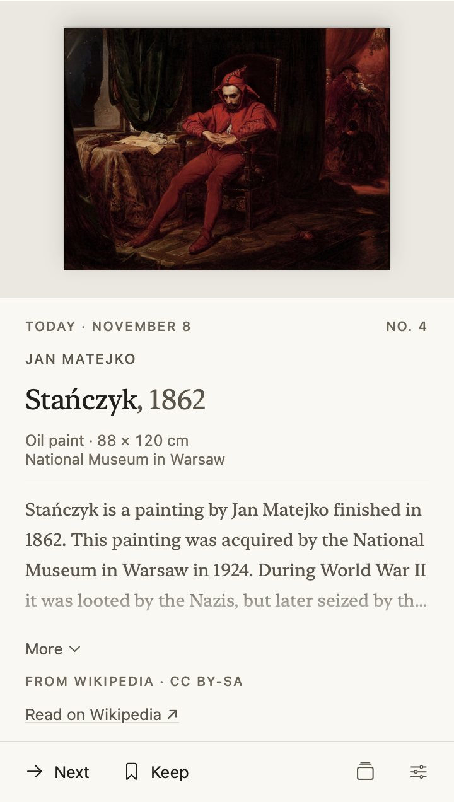
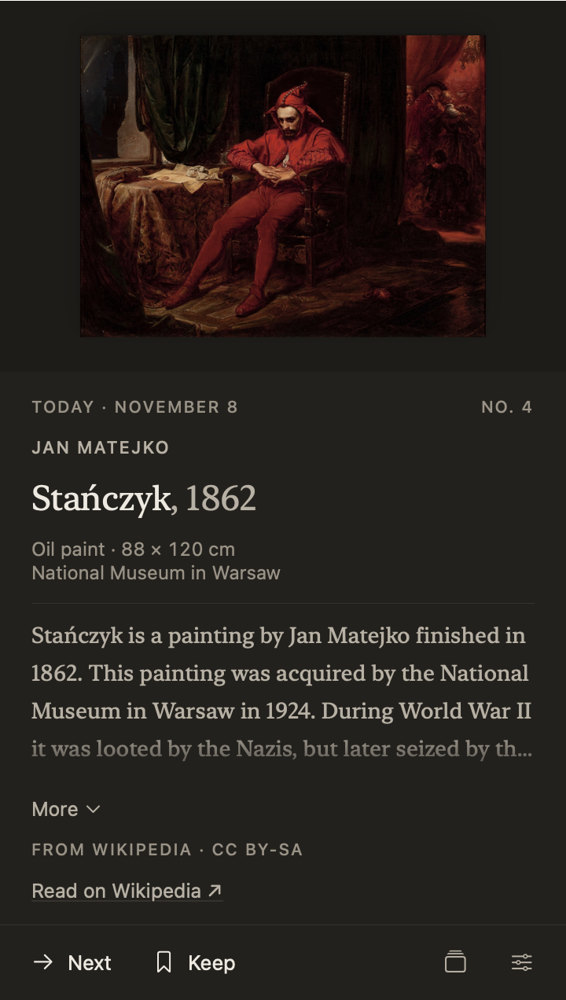
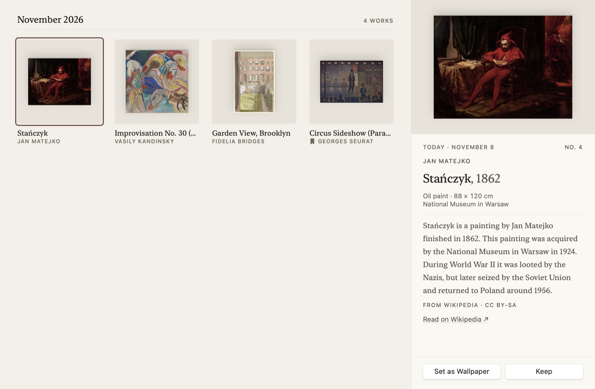
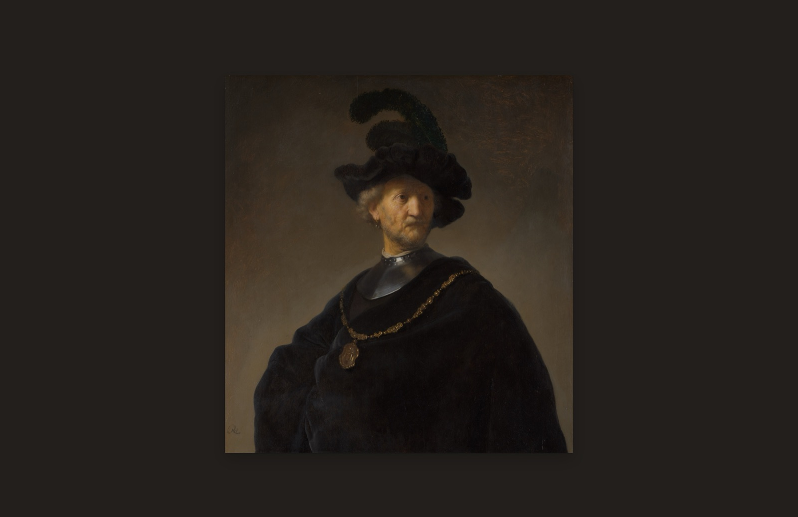
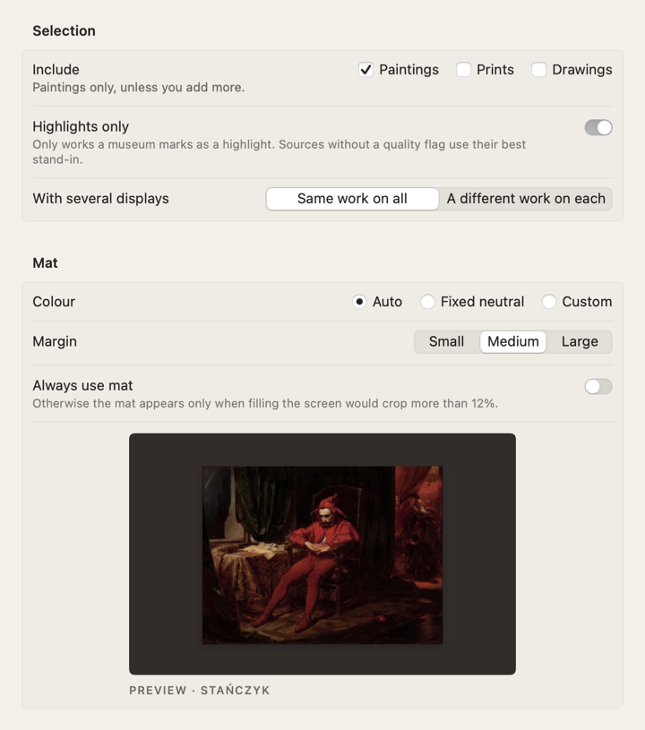
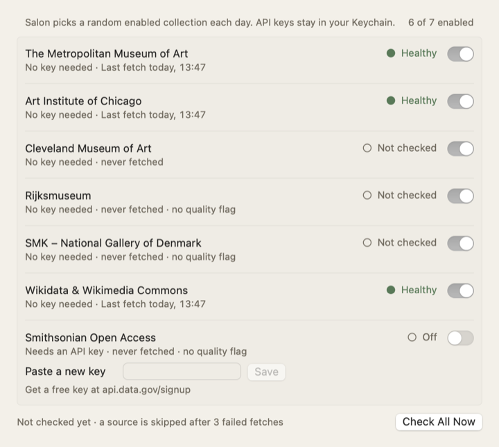

# Salon

A painting a day, from the world's open collections.

Salon is a small macOS menu-bar app that sets your desktop wallpaper to a random public-domain artwork once a day. Works come from several museums' open-access APIs. Full information about each work (title, artist, date, museum and a short description) lives in the menu-bar popover, styled like a museum wall label. Nothing is ever drawn on the desktop except the artwork itself.

<p>
  
  
</p>

It's a personal project: no App Store, no notarization, no sandbox. It's the first app in a suite of personal tools under the `xyz.bogdansimon.*` namespace.

## What it does

- **One new work per calendar day** at a time you choose. It also checks at launch and on wake, so a closed lid never means a skipped day. If you're offline, the current wallpaper stays and Salon retries with backoff (15 min, 30 min, 1 h, … up to 4 h).
- **Fully random.** It picks an enabled source at random, then a random qualifying work from it. There's no taste weighting, and a work is never shown twice.
- **Full-bleed or museum mat.** If filling the screen would crop at most 12% of the painting, it's shown full-bleed. Otherwise the whole painting hangs on a mat whose colour is sampled from the painting's edges, with a soft shadow, slightly above centre. Each display is rendered at its native resolution.
- **History and Kept.** A gallery of everything that has hung, with favourites, search and "Set as Wallpaper" to bring a work back.
- **Sources health.** Shows the last fetch and the last error, and marks each source healthy, degraded or failing. A source is skipped after 3 failures in a row.

<p>
  
</p>
<p>
  
</p>
<p>
  
  
</p>

## Sources

| Source | Key | Quality flag used for "Highlights only" | Max image | Notes |
|---|---|---|---|---|
| The Metropolitan Museum of Art | none | `isHighlight` | original | Descriptions come from Wikipedia via Wikidata |
| Art Institute of Chicago | none | `is_boosted` | 3000 px (IIIF cap) | Best descriptions |
| Cleveland Museum of Art | none | `highlight` | ~3400 px | "Did you know" text |
| Rijksmuseum | none | none (all paintings) | full | Linked Art API; ~5,000 painting ids cached monthly; paintings only |
| SMK – National Gallery of Denmark | none | has exhibition history | 5120 px | |
| Wikidata & Wikimedia Commons | none | ≥ 15 Wikipedia language editions | ≤ 4096 px | Famous works from museums with no open API (Louvre, Prado, Uffizi…); list cached weekly |
| Smithsonian Open Access | free [api.data.gov](https://api.data.gov/signup/) key | none | 3000 px | Off by default |

Every image must be at least **3000 px on its long side**, and no more than 3:1 in shape (handscrolls are skipped). When an image is smaller than a display needs for full-bleed, it goes on the mat instead of being stretched.

Not included: the Louvre, the National Gallery (London), the Prado and the Uffizi offer no open-licence image API, so their famous works arrive through Wikidata instead. Europeana was evaluated but left out because many of its images fall below 3000 px.

## Build and install

Requirements: macOS 14 or later, Xcode 16, [Homebrew](https://brew.sh).

```sh
brew install xcodegen gitleaks
git clone https://github.com/bogdansimon/salon.git
cd salon
make hooks      # gitleaks pre-commit hook
make install    # Release build → /Applications/Salon.app, then launches it
```

The frame icon appears in the menu bar and the first work is hung within a minute. To start Salon automatically, turn on **Settings › General › Launch at login**.

Other targets: `make test`, `make build`, `make run`, `make project` (regenerates `Salon.xcodeproj` from `project.yml`; the project file isn't committed).

### Signing

By default the app is signed ad hoc ("Sign to Run Locally"), which is enough to run it on your own Mac. If you rebuild often, sign with your Apple ID team instead, so the Keychain and Login Items don't ask again after each rebuild:

```sh
cp Local.xcconfig.example Local.xcconfig   # gitignored
# set DEVELOPMENT_TEAM to your team id
```

## Adding a source

1. Create `SalonCore/Sources/<Name>Source.swift` conforming to `ArtSource`:
   - `info`: the name, supported object types, whether it has a quality flag or needs a key, and its credit line.
   - `randomArtwork(for:)`: return a random public-domain `Artwork` that isn't in `query.excludedIDs`. Respect `query.highlightsOnly` and `query.objectTypes`.
   - `healthCheck(apiKey:)`: one cheap request.
   - Optionally `warmUp()`, if the source needs a cached list (see `RijksmuseumSource`).
2. Add one line to `SourceRegistry.all`.
3. Record a fixture in `scripts/record-fixtures.sh` and add a test in `SalonCoreTests/SourceAdapterTests.swift`.

The picker handles everything else: random choice, fallback to other sources, image download, the resolution and shape checks, the no-repeat rule and health.

## Where data lives

Everything is in `~/Library/Application Support/Salon/`:

| Path | Contents |
|---|---|
| `settings.json` | All settings (one typed model, `AppSettings`) |
| `history.json` | Every hung work with its metadata, palette and Kept date |
| `shown.json` | Ids of every work ever shown, so works never repeat, even after Clear History |
| `health.json`, `state.json` | Source health; last change time and what's on screen |
| `Images/` | Full-size downloads (LRU cache, 1 GB by default; kept works are never evicted) |
| `Wallpapers/` | The rendered wallpapers currently on screen (older ones are deleted) |
| `Catalogs/` | Cached work lists for Rijksmuseum and Wikidata |

JSON was chosen over SwiftData because the data is small (a few hundred records), it's easy to read and back up, export is trivial, and there are no schema migrations to manage.

To reset Salon, quit it and delete that folder.

## API keys and secrets

- API keys are typed into **Settings › Sources** and stored only in the macOS Keychain (service `xyz.bogdansimon.salon.api-keys`). They never go into code, plists, UserDefaults, `settings.json` or the repo. A unit test checks that settings never contain a key.
- Test fixtures are real API responses, scrubbed by `scripts/scrub-fixtures.py`. `FixtureHygieneTests` fails if a key or a personal path ever appears in one.
- Signing settings belong in the gitignored `Local.xcconfig`.
- A [gitleaks](https://github.com/gitleaks/gitleaks) pre-commit hook (`make hooks`) blocks secrets, keys in URLs, signing team ids and personal home paths.

## Project layout

```
Salon/            App: SwiftUI views, AppModel, macOS services (wallpaper, scheduler, hot key)
  Theme/          Design tokens: colours, type, spacing, radii, motion. Views use nothing else.
SalonCore/        Framework, no UI: sources, picker, rendering, storage, scheduling
SalonCoreTests/   Unit tests and scrubbed fixtures (no network)
design/           Source designs (HTML artboards) – the visual source of truth
scripts/          Fixture recording/scrubbing, icon rendering, git hooks
```

## Credits

Artwork images and data come from the open-access programmes of The Metropolitan Museum of Art, the Art Institute of Chicago, the Cleveland Museum of Art, the Rijksmuseum, SMK – National Gallery of Denmark, Wikidata and Wikimedia Commons, and the Smithsonian Institution. Descriptions marked "From Wikipedia" are from Wikipedia under CC BY-SA. Salon is not affiliated with any of these institutions.

## License

[MIT](LICENSE)
